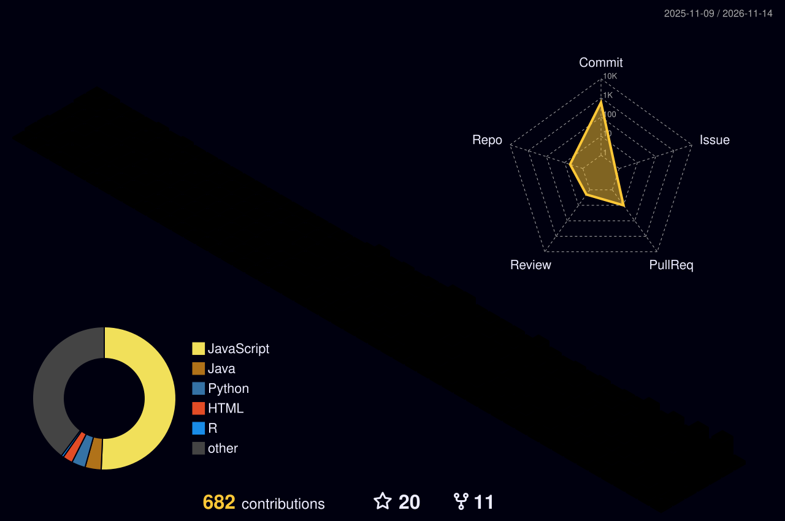

# I'm Pride

**Computational Biomedicine** &nbsp;/&nbsp; Bioinformatics &nbsp;/&nbsp; Biomedical Informatics

 

I'm a computational biomedicine student studying research bioinformatics, biomedical informatics and computational biology. I am involved in a wide array of omics (pharmacogenomics, transcriptomics, metabolomics), clinical psychopathology, neurobiology, and psychiatric medicine. I have participated in and coauthored federally sponsored research; developing computational models to analyze metatranscriptomic data, predictive analytics in pharmacogenomics, cladistics, phylogeny and plant taxonomy, and identifying responsive metabolic composites answering ecological growth of the endangered and largest plant species in the world.

Bioinformatics Consultant for U.S. Botanic Garden.  
Developer for [@ProjectKorra](https://github.com/ProjectKorra).

### Research

`Microbes and metabolites of a plant-parasite interaction: Deciphering the ecology of Tetrastigma host choice in the world’s largest parasitic flower, Rafflesia.` 
([2025](https://doi.org/10.1016/j.cpb.2025.100456))

`Untargeted metabolomics reveals host responses and metabolites linked to host compatibility in Rafflesiaceae parasitism.` ([2026](https://doi.org/10.64898/2026.07.19.739411))

### What Else?

You might find me watching a lot of films because that's probably where I would've ended up if I hadn't touched a computer. That is Oscar Isaac on my profile picture.

> ***In Oscar Isaac we trust.***

 

  

| | |
| :--- | :--- |
| **Languages** |  |
| **Frameworks** |  |
| **Data** |  |
| **Cloud** |  |
| **Build & DevOps** |  |
| **Environment** |  |

 

  <picture>
    <source media="(prefers-color-scheme: dark)" srcset="./profile-3d-contrib/profile-night-rainbow.svg">
    <source media="(prefers-color-scheme: light)" srcset="./profile-3d-contrib/profile-season.svg">
    
  </picture>

<!--  -->
